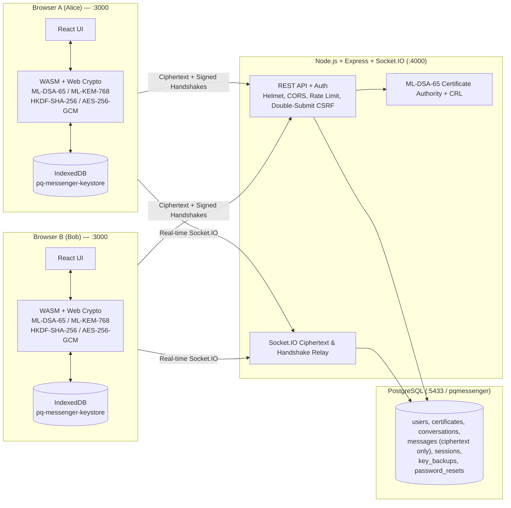
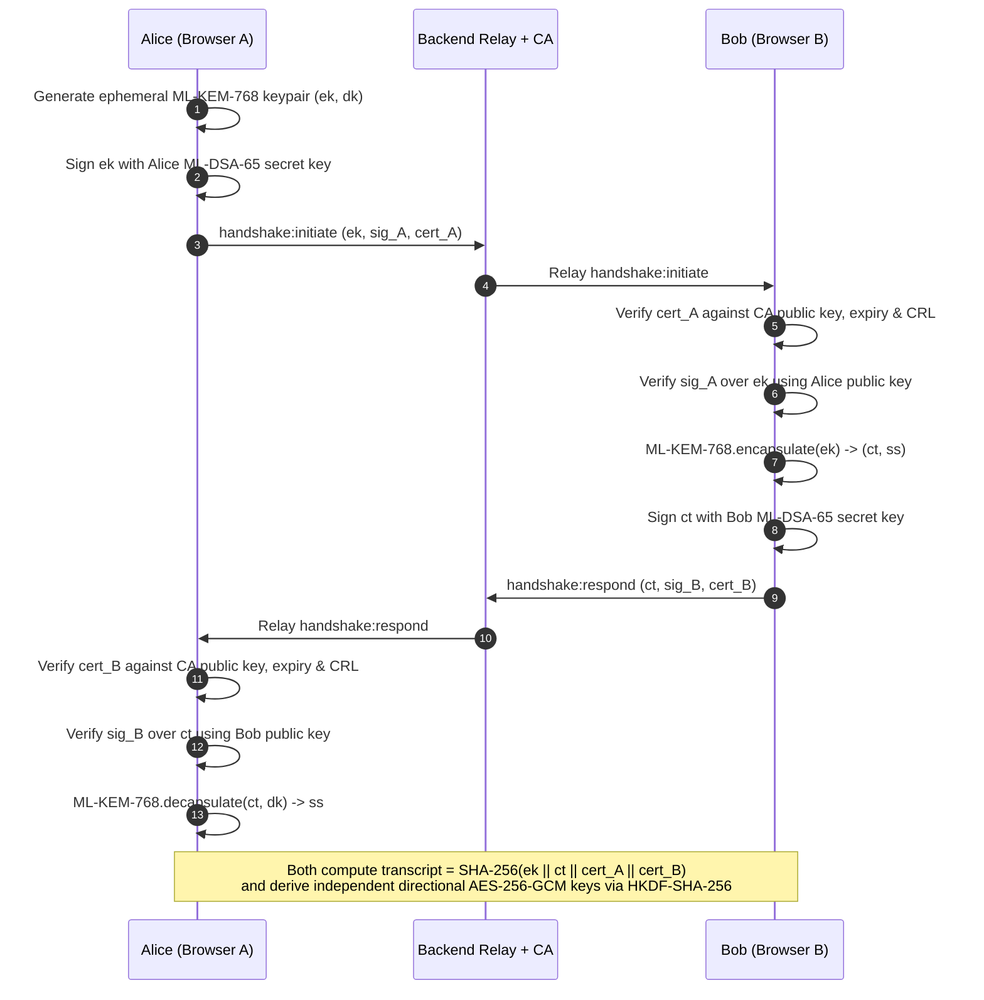

# PQ Messenger — Post-Quantum End-to-End Encrypted Messaging Platform


**PQ Messenger** is a full-stack, zero-knowledge, **post-quantum end-to-end encrypted (E2EE)** real-time messaging web application. All long-term identity key generation, ephemeral post-quantum key encapsulation, directional session key derivation, and symmetric authenticated encryption happen **exclusively inside the user's browser** using WebAssembly (`@oqs/liboqs-js`) and the Web Crypto API.

The Node.js/Express/Socket.IO backend and PostgreSQL database act strictly as an authenticated **ciphertext relay**, **encrypted private-key backup vault**, and **post-quantum Certificate Authority (CA)** — never seeing plaintext messages, unencrypted private keys, or session secrets.

---

## Cryptographic Architecture

| Algorithm | Standard | Responsibility | Execution Location |
| :--- | :--- | :--- | :--- |
| **ML-DSA-65** | NIST FIPS 204 | Identity key pairs, CA certificate signing, and mutual handshake authentication | Browser (WASM) & Server CA |
| **ML-KEM-768** | NIST FIPS 203 | Ephemeral post-quantum shared-secret establishment (`encapsulate` / `decapsulate`) | Browser (WASM) |
| **HKDF-SHA-256** | RFC 5869 | Transcript-bound directional session key derivation (`alice-to-bob` & `bob-to-alice`) | Browser (Web Crypto) |
| **AES-256-GCM** | NIST SP 800-38D | Authenticated message encryption with unique 96-bit nonces and canonicalized AAD | Browser (Web Crypto) |
| **Argon2id** | RFC 9106 | Password hashing for account authentication | Server (`argon2`) |
| **PBKDF2-SHA-256** | RFC 8018 | Client-side password-based encryption (`150,000` iterations + AES-256-GCM) for key backups | Browser (Web Crypto) |

### System & Protocol Flow



### Mutually Authenticated Handshake



---

## Key Features

- **Real Post-Quantum Cryptography:** Uses `@oqs/liboqs-js` (liboqs compiled to WebAssembly) for `ML-DSA-65` and `ML-KEM-768` — no mocked encryption or classical substitution.
- **Trusted Certificate Authority & CRL:** Dedicated server-side ML-DSA-65 CA issues signed JSON certificates, tracks expiration, maintains a Certificate Revocation List (`GET /api/certificates/crl`), and rejects revoked/expired certificates.
- **Zero-Knowledge Relay & Storage:** Both `POST /api/messages` and Socket.IO `message:send` reject payloads containing `plaintext`. PostgreSQL stores only ciphertext, nonces, tags, and routing metadata.
- **Replay & Tamper Protection:** AES-256-GCM binds canonicalized `{ seq, senderId, timestamp }` AAD; both client (`ReplayProtector`) and server (monotonic `sequence_number` + unique `messageId` + PostgreSQL partial unique index) reject replayed or modified messages.
- **Encrypted Key Backup & Recovery:** Private signing keys are kept in IndexedDB (`pq-messenger-keystore`) and optionally backed up encrypted with a PBKDF2-SHA-256 + AES-256-GCM key derived from the user's password.
- **Web Hardening:** Argon2id password hashing, HttpOnly `SameSite=Strict` JWT cookies + active session tracking, strict `crypto.timingSafeEqual` double-submit CSRF protection, Helmet headers, CORS, and rate limiting.
- **Cybersecurity-Themed Responsive UI:** Landing page, registration with live PQ keygen progress, login with encrypted key recovery, password reset, user discovery & real-time chat dashboard, and Security Details inspector (`/security`).

---

## Repository Structure

```text
Applied-Crypto-TA2-Project/
├── README.md
├── .gitignore
├── docs/
│   ├── architecture.md                 # System diagram, DB schema, REST & Socket.IO API reference
│   ├── cryptography.md                 # Sequence diagrams, key sizes, KDF, AEAD & CRL specs
│   └── threat-model.md                 # Assets, trust boundaries, mitigations & limitations
├── server/                             # Node.js + Express 5 + Socket.IO + TypeScript (:4000)
│   ├── package.json
│   ├── tsconfig.json
│   ├── src/
│   │   ├── index.ts                    # Express + Socket.IO bootstrap
│   │   ├── config.ts                   # Port, JWT, CORS, and PostgreSQL configuration
│   │   ├── db.ts                       # PostgreSQL pool & schema initialization
│   │   ├── socket.ts                   # Authenticated Socket.IO relay
│   │   ├── ca/
│   │   │   └── certificate-authority.ts # ML-DSA-65 CA issuance, verification & CRL
│   │   ├── middleware/
│   │   │   ├── auth.ts                 # JWT + active-session authentication
│   │   │   └── security.ts             # Helmet, CORS, rate limiters & strict CSRF
│   │   ├── services/
│   │   │   └── messageService.ts       # Participant checks, replay guard & ciphertext storage
│   │   └── routes/
│   │       ├── auth.ts                 # Register, login, logout, refresh, me, password reset
│   │       ├── users.ts                # User search & profile lookup
│   │       ├── certificates.ts         # CA public key, cert issue/verify/revoke & CRL
│   │       ├── conversations.ts        # Conversations & paginated encrypted history
│   │       ├── messages.ts             # Encrypted message submission & read/delivery receipts
│   │       └── keys.ts                 # Encrypted private-key backup endpoints
│   └── tests/
│       └── security-integration.test.ts # 9-test security & integration suite
└── client/                             # React 19 + TypeScript + Vite 8 + Tailwind CSS v4 (:3000)
    ├── package.json
    ├── vite.config.ts                  # /api & /socket.io proxy to :4000
    └── src/
        ├── App.tsx                     # Routes: /, /register, /login, /reset-password, /dashboard, /security
        ├── crypto/
        │   ├── pq-crypto.ts            # @oqs/liboqs-js ML-DSA-65 & ML-KEM-768 WASM wrappers
        │   ├── symmetric.ts            # HKDF-SHA-256 & AES-256-GCM with canonicalized AAD
        │   ├── handshake.ts            # Authenticated ML-KEM-768 handshake & ReplayProtector
        │   └── key-management.ts       # IndexedDB keystore & PBKDF2 encrypted key backup
        ├── contexts/                   # AuthContext, CryptoContext, SocketContext
        ├── services/                   # REST API client (with CSRF handling) & Socket.IO client
        ├── components/                 # Chat UI, CertificateViewer, EncryptionBadge, UserSearch
        └── pages/                      # Landing, Register, Login, PasswordReset, Dashboard, Security
```

---

## Getting Started

### Prerequisites

- **Node.js** v20+ (tested on Node v24) & `npm`
- **PostgreSQL** 15+ (tested on PostgreSQL 17)

### 1. Database Setup (PostgreSQL)

By default, [`server/src/config.ts`](server/src/config.ts) connects to a PostgreSQL database named `pqmessenger`:

```ts
db: {
  host: '/home/toji/.local/pgdata',
  port: 5433,
  user: 'toji',
  database: 'pqmessenger',
}
```

> If you are running on a different machine or using the standard system PostgreSQL service (`localhost:5432`, user `postgres`), update `db` in `server/src/config.ts` accordingly and create the `pqmessenger` database:
> ```bash
> createdb pqmessenger
> ```

On startup, `initDatabase()` in [`server/src/db.ts`](server/src/db.ts) automatically creates all 7 tables (`users`, `certificates`, `conversations`, `messages`, `sessions`, `key_backups`, `password_resets`) and indexes.

### 2. Install & Run Backend (`server/`)

```bash
cd server
npm install
npm run dev        # Starts Express + Socket.IO + ML-DSA-65 CA on http://localhost:4000
```

Production build:

```bash
npx tsc --noEmit && npm run build && npm start
```

### 3. Install & Run Frontend (`client/`)

In a second terminal:

```bash
cd client
npm install
npm run dev        # Starts Vite dev server on http://localhost:3000
```

Production check:

```bash
npx tsc --noEmit && npm run build
```

---

## Automated Security & Integration Tests

Run the backend security test suite (`server/tests/security-integration.test.ts`):

```bash
cd server
npm test
```

The suite verifies **9 end-to-end security & cryptographic scenarios**:
1. Argon2id registration & weak-password rejection
2. Rejection of unauthenticated REST and Socket.IO connections (plus strict CSRF `403` enforcement)
3. Distinct ML-DSA-65 identity generation & valid CA-signed certificates for Alice and Bob
4. Rejection of invalid, expired, and revoked certificates and forged ML-DSA-65 signatures
5. Matching ML-KEM-768 shared secrets and distinct directional HKDF-SHA-256 keys
6. AES-256-GCM encryption/decryption and rejection of tampered ciphertext, tag, or AAD
7. Non-participant access denial, replay protection, and zero-knowledge ciphertext-only DB storage
8. Socket.IO real-time handshake/ciphertext relay, receipts, and socket replay rejection
9. Encrypted key backup recovery and password reset invalidating prior credentials and sessions

---

## Two-User Demo Walkthrough (Alice & Bob)

Because IndexedDB and cookies are shared across tabs in a single browser profile, use **two separate browser profiles** (e.g., normal browser window + Incognito/Private window or a second browser):

1. **Window A (Alice):** Open `http://localhost:3000/register` and register `alice`. Client-side WASM generates an ML-DSA-65 keypair, obtains a CA certificate, stores the secret key in IndexedDB, and uploads an encrypted backup.
2. **Window B (Bob):** Open `http://localhost:3000/register` in an isolated browser session and register `bob`.
3. **Inspect Security Details:** Visit `/security` in either window to view the public key fingerprint, CA signature verification, certificate validity, and CRL status.
4. **Discover & Handshake:** From Alice's Dashboard, search for `bob` and open a conversation. Click **Establish PQ Session** (or **Start ML-KEM Handshake**) while both users are online until the badge reads **PQ E2EE Active**.
5. **Exchange Encrypted Messages:** Send messages in both directions between Alice and Bob and verify real-time decryption, sequence numbers, and delivery/read receipts.
6. **Verify Zero-Knowledge Database Storage:**
   ```bash
   psql -d pqmessenger -c "SELECT id, sequence_number, left(ciphertext, 32) AS ct_prefix, left(nonce, 16) AS iv, left(tag, 16) AS tag FROM messages;"
   ```

---

## Additional Documentation

- [**System Architecture, Schema & API Reference**](docs/architecture.md)
- [**Cryptographic Protocols, Parameters & Workflows**](docs/cryptography.md)
- [**Threat Model, Mitigations & Security Limitations**](docs/threat-model.md)
