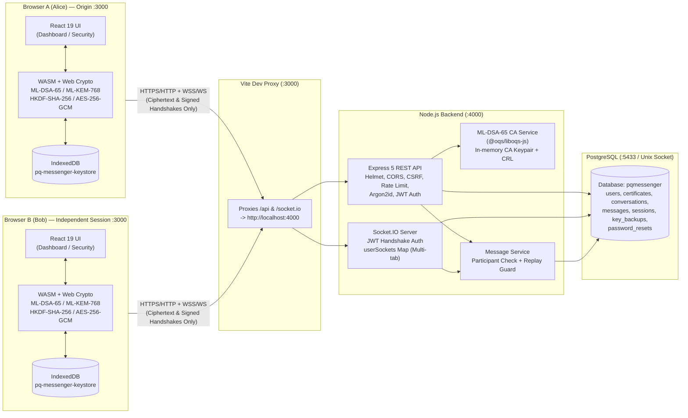

# System Architecture, Database Schema & API Reference

This document describes the runtime architecture, repository layout, PostgreSQL schema, REST endpoints, and Socket.IO event contracts implemented in PQ Messenger.

---

## High-Level System Architecture



### Architectural Separation of Trust

- **Clients (`client/`):** Hold raw ML-DSA-65 identity secret keys in IndexedDB, ephemeral ML-KEM-768 secrets in memory, and derived AES-256-GCM `CryptoKey` handles in memory (`non-extractable` in `symmetric.ts`). All encryption, decryption, signing, and peer certificate verification happen inside the browser.
- **Server (`server/`):** Operates an in-memory ML-DSA-65 Certificate Authority, authenticates HTTP/WebSocket sessions via JWT + PostgreSQL session hashes, enforces message replay rules, relays Socket.IO handshakes/ciphertexts, and persists ciphertext + encrypted key backups in PostgreSQL.

---

## Repository Folder Structure

```text
TA-2-Project/
├── README.md
├── docs/
│   ├── architecture.md
│   ├── cryptography.md
│   └── threat-model.md
├── client/                                 # React 19 + TypeScript + Vite 8 frontend (:3000)
│   ├── package.json
│   ├── tsconfig.json
│   ├── vite.config.ts                      # /api and /socket.io proxy -> :4000; excludes @oqs/liboqs-js from optimizeDeps
│   └── src/
│       ├── App.tsx                         # Routes: /, /register, /login, /reset-password, /dashboard, /security
│       ├── main.tsx
│       ├── index.css
│       ├── types/index.ts                  # User, Certificate, Message, Conversation, CryptoIdentity, SessionKeys, etc.
│       ├── crypto/
│       │   ├── pq-crypto.ts                # @oqs/liboqs-js WASM wrapper (ML-DSA-65, ML-KEM-768) + SHA-256 + Base64
│       │   ├── handshake.ts                # Mutual PQ handshake, verifyPeerCertificate, computeHandshakeTranscript, ReplayProtector
│       │   ├── symmetric.ts                # HKDF-SHA-256 directional key derivation & AES-256-GCM encrypt/decrypt
│       │   └── key-management.ts           # IndexedDB identity store + PBKDF2-SHA-256 / AES-256-GCM key backup wrap/unwrap
│       ├── contexts/
│       │   ├── AuthContext.tsx             # Login/register/logout/refreshUser, sessionStorage socket token
│       │   ├── CryptoContext.tsx           # WASM init, identity lifecycle, handshake state, sessionKeys, encrypt/decrypt API
│       │   └── SocketContext.tsx           # Socket.IO lifecycle & global handshake:initiate / handshake:respond handlers
│       ├── services/
│       │   ├── api.ts                      # Fetch client with automatic X-CSRF-Token & snake_case->camelCase normalizers
│       │   └── socket.ts                   # SocketService wrapper for outbound emits and event subscriptions
│       ├── pages/
│       │   ├── LandingPage.tsx
│       │   ├── RegisterPage.tsx
│       │   ├── LoginPage.tsx
│       │   ├── PasswordResetPage.tsx
│       │   ├── DashboardPage.tsx           # Conversation list, user search, handshake initiation, encrypted chat view
│       │   └── SecurityPage.tsx            # Local cert inspection, CA endpoint verification, key rotation, revocation, CRL
│       └── components/
│           ├── CertificateViewer.tsx
│           ├── ConversationList.tsx
│           ├── EncryptionBadge.tsx
│           ├── Layout.tsx
│           ├── MessageBubble.tsx
│           ├── MessageInput.tsx
│           ├── OnlineIndicator.tsx
│           └── UserSearch.tsx
└── server/                                 # Node.js + Express 5 + Socket.IO + TypeScript backend (:4000)
    ├── package.json
    ├── tsconfig.json
    ├── tests/
    │   └── security-integration.test.ts    # 9-test node:test end-to-end cryptographic & API/Socket integration suite
    └── src/
        ├── config.ts                       # Port (4000), JWT config (24h), PostgreSQL socket (/home/toji/.local/pgdata:5433), CORS, cert validity (365d)
        ├── db.ts                           # pg Pool, query() helper, initDatabase() schema & index DDL
        ├── index.ts                        # createServerApp() & bootstrap(): middleware, routes, Socket.IO, DB, CA + CRL sync
        ├── socket.ts                       # Socket.IO JWT auth, userSockets map, message/handshake/receipt/typing/presence events
        ├── ca/
        │   └── certificate-authority.ts    # ML-DSA-65 CA keygen, issueCertificate, verifyCertificate, revokeCertificate, getCRL, getCAPublicKey
        ├── middleware/
        │   ├── auth.ts                     # authMiddleware: JWT verification (cookie or Bearer) + sessions revocation/expiry check
        │   └── security.ts                 # Helmet, CORS, authRateLimit (100/15m), generalRateLimit (1000/15m), CSRF double-submit cookie
        ├── services/
        │   └── messageService.ts           # storeEncryptedMessage(): participant check, duplicate messageId & monotonic seq enforcement
        └── routes/
            ├── auth.ts                     # /api/auth/* (register, login, logout, me, refresh, password-reset)
            ├── users.ts                    # /api/users/* (search, get by id)
            ├── certificates.ts             # /api/certificates/* & caRouter (/api/ca/public-key)
            ├── conversations.ts            # /api/conversations/* (list, create/get, paginated messages)
            ├── messages.ts                 # /api/messages/* (store ciphertext, update status)
            └── keys.ts                     # /api/keys/backup (POST, GET)
```

---

## PostgreSQL Database Schema

Initialized automatically by `initDatabase()` in [`server/src/db.ts`](../server/src/db.ts) inside a transaction.

### Tables

#### 1. `users`
| Column | Type | Constraints / Default | Notes |
| :--- | :--- | :--- | :--- |
| `id` | `UUID` | `PRIMARY KEY DEFAULT gen_random_uuid()` | Assigned via `uuidv4()` on registration |
| `username` | `VARCHAR(50)` | `UNIQUE NOT NULL` | 3–50 characters |
| `email` | `VARCHAR(255)` | `UNIQUE NOT NULL` | Normalized via `express-validator` |
| `password_hash` | `TEXT` | `NOT NULL` | Argon2id (`argon2.argon2id`) hash |
| `created_at` | `TIMESTAMPTZ` | `DEFAULT NOW()` | |
| `updated_at` | `TIMESTAMPTZ` | `DEFAULT NOW()` | |
| `is_online` | `BOOLEAN` | `DEFAULT FALSE` | Updated on first/last Socket.IO connection |
| `last_seen` | `TIMESTAMPTZ` | `DEFAULT NOW()` | Updated on final socket disconnect |

#### 2. `certificates`
| Column | Type | Constraints / Default | Notes |
| :--- | :--- | :--- | :--- |
| `id` | `UUID` | `PRIMARY KEY DEFAULT gen_random_uuid()` | |
| `user_id` | `UUID` | `NOT NULL REFERENCES users(id) ON DELETE CASCADE` | |
| `public_signing_key` | `TEXT` | `NOT NULL` | Base64 ML-DSA-65 public key |
| `certificate` | `TEXT` | `NOT NULL` | Exact canonical JSON string signed by the CA |
| `ca_signature` | `TEXT` | `NOT NULL` | Base64 ML-DSA-65 CA signature over `certificate` |
| `issued_at` | `TIMESTAMPTZ` | `DEFAULT NOW()` | |
| `expires_at` | `TIMESTAMPTZ` | `NOT NULL` | `issued_at + 365 days` |
| `is_revoked` | `BOOLEAN` | `DEFAULT FALSE` | Synced to in-memory CA CRL on startup/revocation |
| `revoked_at` | `TIMESTAMPTZ` | nullable | |
| `fingerprint` | `VARCHAR(128)` | `UNIQUE NOT NULL` | SHA-256 hex digest of `public_signing_key` string |

#### 3. `conversations`
| Column | Type | Constraints / Default | Notes |
| :--- | :--- | :--- | :--- |
| `id` | `UUID` | `PRIMARY KEY DEFAULT gen_random_uuid()` | |
| `participant_a` | `UUID` | `NOT NULL REFERENCES users(id) ON DELETE CASCADE` | Lexicographically smaller UUID |
| `participant_b` | `UUID` | `NOT NULL REFERENCES users(id) ON DELETE CASCADE` | Lexicographically larger UUID |
| `created_at` | `TIMESTAMPTZ` | `DEFAULT NOW()` | |
| `updated_at` | `TIMESTAMPTZ` | `DEFAULT NOW()` | Updated when a message is stored |
| — | `UNIQUE` | `(participant_a, participant_b)` | Ensures at most one conversation per user pair |

#### 4. `messages`
| Column | Type | Constraints / Default | Notes |
| :--- | :--- | :--- | :--- |
| `id` | `UUID` | `PRIMARY KEY DEFAULT gen_random_uuid()` | Client may supply UUID for replay deduplication |
| `conversation_id` | `UUID` | `NOT NULL REFERENCES conversations(id) ON DELETE CASCADE` | |
| `sender_id` | `UUID` | `NOT NULL REFERENCES users(id) ON DELETE CASCADE` | |
| `ciphertext` | `TEXT` | `NOT NULL` | Base64 AES-256-GCM ciphertext (tag stripped) |
| `nonce` | `VARCHAR(64)` | nullable | Base64 12-byte IV/nonce |
| `iv` | `VARCHAR(64)` | nullable | Base64 12-byte IV (mirrors `nonce`) |
| `tag` | `VARCHAR(128)` | nullable | Base64 16-byte GCM authentication tag |
| `sequence_number` | `BIGINT` | nullable | Strictly monotonic per `(conversation_id, sender_id)` |
| `metadata` | `JSONB` | nullable | Authenticated AAD metadata (e.g., `senderId`, `timestamp`) |
| `created_at` | `TIMESTAMPTZ` | `DEFAULT NOW()` | |
| `delivered_at` | `TIMESTAMPTZ` | nullable | |
| `read_at` | `TIMESTAMPTZ` | nullable | |
| `status` | `VARCHAR(20)` | `DEFAULT 'sent'` | `'sent'`, `'delivered'`, or `'read'` |

#### 5. `sessions`
| Column | Type | Constraints / Default | Notes |
| :--- | :--- | :--- | :--- |
| `id` | `UUID` | `PRIMARY KEY DEFAULT gen_random_uuid()` | |
| `user_id` | `UUID` | `NOT NULL REFERENCES users(id) ON DELETE CASCADE` | |
| `token_hash` | `VARCHAR(128)` | `NOT NULL` | SHA-256 hex digest of JWT |
| `created_at` | `TIMESTAMPTZ` | `DEFAULT NOW()` | |
| `expires_at` | `TIMESTAMPTZ` | `NOT NULL` | 24 hours from issuance |
| `is_active` | `BOOLEAN` | `DEFAULT TRUE` | Set `FALSE` on logout, refresh, or password reset |

#### 6. `key_backups`
| Column | Type | Constraints / Default | Notes |
| :--- | :--- | :--- | :--- |
| `id` | `UUID` | `PRIMARY KEY DEFAULT gen_random_uuid()` | |
| `user_id` | `UUID` | `NOT NULL REFERENCES users(id) ON DELETE CASCADE` | One active row per user (previous deleted on upload) |
| `encrypted_private_key` | `TEXT` | `NOT NULL` | Base64 AES-256-GCM encrypted ML-DSA-65 secret key |
| `salt` | `TEXT` | `NOT NULL` | Base64 16-byte PBKDF2-SHA-256 salt |
| `iv` | `TEXT` | `NOT NULL` | Base64 12-byte AES-GCM IV |
| `created_at` | `TIMESTAMPTZ` | `DEFAULT NOW()` | |

#### 7. `password_resets`
| Column | Type | Constraints / Default | Notes |
| :--- | :--- | :--- | :--- |
| `id` | `UUID` | `PRIMARY KEY DEFAULT gen_random_uuid()` | |
| `user_id` | `UUID` | `NOT NULL REFERENCES users(id) ON DELETE CASCADE` | |
| `token_hash` | `VARCHAR(128)` | `UNIQUE NOT NULL` | SHA-256 hex digest of 32-byte random reset token |
| `expires_at` | `TIMESTAMPTZ` | `NOT NULL` | 15 minutes from request |
| `used` | `BOOLEAN` | `DEFAULT FALSE` | Invalidated on use or newer reset request |
| `created_at` | `TIMESTAMPTZ` | `DEFAULT NOW()` | |

### Indexes
- `idx_messages_conversation_created` ON `messages(conversation_id, created_at)`
- `idx_messages_replay_seq` UNIQUE ON `messages(conversation_id, sender_id, sequence_number) WHERE sequence_number IS NOT NULL`
- `idx_certificates_user_id` ON `certificates(user_id)`
- `idx_sessions_user_id` ON `sessions(user_id)`
- `idx_password_resets_user_id` ON `password_resets(user_id)`

---

## REST API Reference

All state-changing routes (`POST`, `PUT`, `PATCH`, `DELETE`) pass through `csrfProtection` (strict double-submit `csrf-token` cookie + `X-CSRF-Token` header verified via `crypto.timingSafeEqual`; clients fetch `GET /api/csrf-token` first). Protected routes require `authMiddleware` (valid JWT in `token` cookie or `Authorization: Bearer <token>`, verified active in `sessions`).

### System & CSRF

| Method | Path | Auth | Description |
| :--- | :--- | :--- | :--- |
| `GET` | `/api/health` | Public | Returns `{ status: 'ok', service: 'pq-messenger-server' }` |
| `GET` | `/api/csrf-token` | Public | Sets `csrf-token` cookie (`SameSite=Strict`) and returns `{ csrfToken }` |

### Authentication (`/api/auth`)

| Method | Path | Auth | Rate Limit | Request Body / Params | Response / Notes |
| :--- | :--- | :--- | :--- | :--- | :--- |
| `POST` | `/api/auth/register` | Public | `authRateLimit` (100/15m) | `{ username (3–50), email, password (8+, upper/lower/digit), confirmPassword }` | `201`: `{ message, user, token }`; sets `token` HttpOnly cookie, hashes password with Argon2id, creates session |
| `POST` | `/api/auth/login` | Public | `authRateLimit` | `{ email, password }` | `200`: `{ message, user, token }`; verifies Argon2id hash, sets `token` cookie, creates session |
| `POST` | `/api/auth/logout` | Required | General | — | `200`: `{ message }`; marks session `is_active = FALSE`, clears `token` cookie |
| `GET` | `/api/auth/me` | Required | General | — | `200`: `{ user }` (`id, username, email, created_at, is_online, last_seen`) |
| `POST` | `/api/auth/refresh` | Required | General | — | `200`: `{ message, token }`; revokes old session, issues new 24h JWT & session |
| `POST` | `/api/auth/password-reset/request` | Public | `authRateLimit` | `{ email }` | `200`: `{ message, resetToken? }`; creates 15-minute SHA-256 hashed reset token (`resetToken` returned only when `NODE_ENV !== 'production'`) |
| `POST` | `/api/auth/password-reset/confirm` | Public | `authRateLimit` | `{ token, newPassword, confirmPassword }` | `200`: `{ message }`; updates `password_hash`, marks token `used = TRUE`, invalidates all active user `sessions` |

### Users (`/api/users`)

| Method | Path | Auth | Params / Query | Response |
| :--- | :--- | :--- | :--- | :--- |
| `GET` | `/api/users/search` | Required | `?q=<username substring>` | `200`: `{ users }` (max 20 matching users excluding caller: `id, username, is_online, last_seen`) |
| `GET` | `/api/users/:id` | Required | `:id` (UUID) | `200`: `{ user }` (`id, username, is_online, last_seen, created_at`) |

### Certificates & CA (`/api/certificates`, `/api/ca`)

| Method | Path | Auth | Request Body / Params | Response / Notes |
| :--- | :--- | :--- | :--- | :--- |
| `POST` | `/api/certificates/issue` | Required | `{ publicSigningKey }` (Base64 ML-DSA-65 pubkey) | `201`: `{ certificate, caSignature, fingerprint }`; revokes any other active certs for the user and updates CA CRL |
| `GET` | `/api/certificates/user/:userId` | Required | `:userId` (UUID) | `200`: `{ certificate }` (latest non-revoked, non-expired cert row) or `404` |
| `POST` | `/api/certificates/verify` | Public | `{ certificate, caSignature }` | `200`: `{ valid, signatureValid, revoked, expired }` (or `{ valid: false, reason }` on invalid JSON) |
| `POST` | `/api/certificates/revoke` | Required | — | `200`: `{ message: 'Certificate(s) revoked' }`; marks active certs revoked in DB and adds fingerprints to CA CRL |
| `GET` | `/api/certificates/crl` | Public | — | `200`: `{ crl: string[] }` (array of revoked SHA-256 fingerprints) |
| `GET` | `/api/ca/public-key` | Public | — | `200`: `{ publicKey }` (Base64 ML-DSA-65 CA public key) |

### Conversations & Messages (`/api/conversations`, `/api/messages`)

| Method | Path | Auth | Request / Params | Response / Notes |
| :--- | :--- | :--- | :--- | :--- |
| `GET` | `/api/conversations` | Required | — | `200`: `{ conversations }` with `other_user_id`, `other_username`, `other_is_online`, `other_last_seen`, `unread_count`, `last_message` |
| `POST` | `/api/conversations` | Required | `{ participantId }` (UUID, not self) | `200` (`created: false`) or `201` (`created: true`) with `{ conversation, created }` |
| `GET` | `/api/conversations/:id/messages` | Required | `:id` (UUID), `?limit=50` (max 100), `?before=<ISO timestamp>` | `200`: `{ messages, hasMore, myLastSequenceNumber }` in chronological order; enforces participant check (`403` otherwise) and returns caller's max `sequence_number` for replay-safe seeding |
| `POST` | `/api/messages` | Required | `{ conversationId, ciphertext, messageId?, nonce?, iv?, tag?, sequenceNumber?, metadata? }` | `201`: `{ message }`; rejects `plaintext` (`400`), non-participants (`403`), duplicate `messageId` or non-monotonic `sequenceNumber` (`409`) |
| `PUT` | `/api/messages/:id/status` | Required | `:id` (UUID), `{ status: 'delivered' \| 'read' }` | `200`: `{ message }` updating `status` and `delivered_at` / `read_at` |

### Key Backups (`/api/keys`)

| Method | Path | Auth | Request Body | Response / Notes |
| :--- | :--- | :--- | :--- | :--- |
| `POST` | `/api/keys/backup` | Required | `{ encryptedPrivateKey, salt, iv }` | `201`: `{ message, backup }`; replaces any prior backup row for the user |
| `GET` | `/api/keys/backup` | Required | — | `200`: `{ backup }` (`id, user_id, encrypted_private_key, salt, iv, created_at`) or `404` |

---

## Socket.IO Event Reference

Socket.IO attaches to the HTTP server in [`server/src/socket.ts`](../server/src/socket.ts). Connections authenticate via `socket.handshake.auth.token`, `Authorization: Bearer <token>`, or the `token` cookie, verifying JWT validity and checking `sessions` for revocation/expiry. Multiple concurrent tabs per user are tracked in `userSockets: Map<string, Set<string>>`.

### Client → Server Events

| Event | Payload | Behavior / Server Action |
| :--- | :--- | :--- |
| `message:send` | `{ conversationId, recipientId, ciphertext, nonce?, iv?, tag?, sequenceNumber?, metadata?, messageId? }` (+ optional `ack` callback) | Rejects `plaintext` or invalid payloads; calls `storeEncryptedMessage()`; emits `message:receive` to all recipient sockets and sender's other sockets; returns `{ ok: true, message }` or `{ error }` via `ack` |
| `message:delivered` | `{ messageId, conversationId? }` | Updates `status` to `'delivered'` (preserving `'read'`) and `delivered_at` if caller is recipient; emits `message:delivered` to sender |
| `message:read` | `{ messageId, conversationId? }` | Updates `status = 'read'`, `delivered_at`, `read_at` if caller is recipient; emits `message:read` to sender |
| `handshake:initiate` | `{ targetUserId, kemPublicKey, signedKemPublicKey?, signature?, certificate?, caSignature?, conversationId?, senderSigningPublicKey? }` | Validates presence of `targetUserId`, `kemPublicKey`, and signature; relays payload with `fromUserId` and `fromUsername` to `targetUserId` |
| `handshake:respond` | `{ targetUserId, encapsulatedKey?, encapsulatedCiphertext?, signedEncapsulatedKey?, signature?, certificate?, caSignature?, conversationId?, senderSigningPublicKey? }` | Validates presence of `targetUserId`, encapsulated ciphertext, and signature; relays payload with `fromUserId` and `fromUsername` to `targetUserId` |
| `typing:start` | `{ targetUserId, conversationId? }` | Emits `typing:start` (`{ userId, username, conversationId }`) to `targetUserId` |
| `typing:stop` | `{ targetUserId, conversationId? }` | Emits `typing:stop` (`{ userId, username, conversationId }`) to `targetUserId` |

### Server → Client Events

| Event | Payload | Trigger |
| :--- | :--- | :--- |
| `message:receive` | Stored message row (`id, conversation_id, sender_id, ciphertext, nonce, iv, tag, sequence_number, metadata, created_at, delivered_at, read_at, status`) + `clientMessageId` | Sent to recipient sockets and sender's other tabs on `message:send` |
| `message:delivered` | `{ messageId, conversationId, deliveredAt, status }` | Emitted to original sender when recipient acknowledges delivery |
| `message:read` | `{ messageId, conversationId, readAt, status }` | Emitted to original sender when recipient marks message read |
| `handshake:initiate` | Inbound `handshake:initiate` fields + `{ fromUserId, fromUsername }` | Relayed from initiator to `targetUserId` |
| `handshake:respond` | Inbound `handshake:respond` fields + `{ fromUserId, fromUsername }` | Relayed from responder to `targetUserId` |
| `typing:start` / `typing:stop` | `{ userId, username, conversationId? }` | Relayed to `targetUserId` |
| `user:online` | `{ userId, username }` | Broadcast when a user opens their first active socket connection |
| `user:offline` | `{ userId, username, lastSeen }` | Broadcast when a user's last socket disconnects (`users.is_online = FALSE`) |
