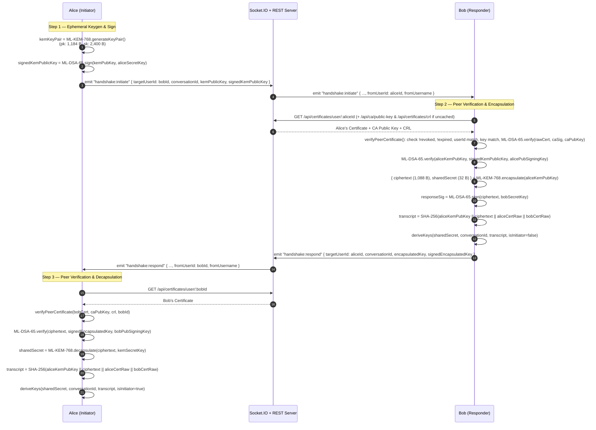
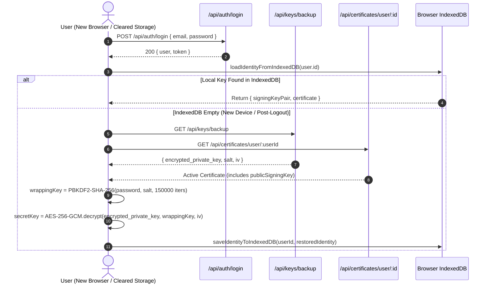

# Cryptographic Architecture & Protocol Specifications

This document specifies the post-quantum and symmetric cryptographic protocols implemented in [`client/src/crypto/`](../client/src/crypto/) and [`server/src/ca/certificate-authority.ts`](../server/src/ca/certificate-authority.ts).

---

## Cryptographic Primitive & Parameter Inventory

Exact parameter sizes verified directly from `@oqs/liboqs-js` (`^0.15.1`) and Web Crypto API calls in the codebase:

| Primitive | Standard | Role | Exact Parameter Sizes & Settings |
| :--- | :--- | :--- | :--- |
| **ML-DSA-65** | NIST FIPS 204 (Level 3) | User identity signatures & CA certificate signing | Public Key: **1,952 bytes**<br>Secret Key: **4,032 bytes**<br>Signature: **3,309 bytes** |
| **ML-KEM-768** | NIST FIPS 203 (Level 3) | Ephemeral post-quantum key encapsulation | Public Key: **1,184 bytes**<br>Secret Key: **2,400 bytes**<br>Ciphertext: **1,088 bytes**<br>Shared Secret: **32 bytes (256 bits)** |
| **HKDF-SHA-256** | RFC 5869 (Web Crypto) | Transcript-bound directional session key derivation | Salt: **32 bytes** (`SHA-256(conversationId \|\| transcript)`)<br>Output Keys: Two **256-bit** `AES-GCM` `CryptoKey` objects (`non-extractable`) |
| **AES-256-GCM** | NIST SP 800-38D (Web Crypto) | Message authenticated encryption & backup wrapping | Key: **256 bits (32 bytes)**<br>IV / Nonce: **96 bits (12 bytes)** CSPRNG per message<br>Tag: **128 bits (16 bytes)** |
| **PBKDF2-SHA-256** | NIST SP 800-132 (Web Crypto) | Password-based key wrapping for private key backups | Salt: **16 bytes** random<br>Iterations: **150,000**<br>Hash: **SHA-256**<br>Derived Key: **256-bit AES-GCM** |
| **SHA-256** | FIPS 180-4 | Fingerprints, transcript digests, HKDF salt, token hashing | Digest: **32 bytes** (64 hex chars for fingerprints/token hashes) |
| **Argon2id** | RFC 9106 (`argon2` pkg) | Server-side user password hashing | `type: argon2.argon2id` (library defaults in `server/src/routes/auth.ts`) |

---

## Workflow 1: User Registration, Client-Side ML-DSA-65 Keygen & CA Issuance

Implemented across [`client/src/pages/RegisterPage.tsx`](../client/src/pages/RegisterPage.tsx), [`client/src/contexts/CryptoContext.tsx`](../client/src/contexts/CryptoContext.tsx), [`server/src/routes/auth.ts`](../server/src/routes/auth.ts), [`server/src/routes/certificates.ts`](../server/src/routes/certificates.ts), and [`server/src/ca/certificate-authority.ts`](../server/src/ca/certificate-authority.ts).

```mermaid
sequenceDiagram
  autonumber
  actor User as Alice (Browser)
  participant Auth as Express /api/auth
  participant WASM as liboqs WASM (ML-DSA-65)
  participant CA as /api/certificates & CA
  participant IDB as Browser IndexedDB
  participant Keys as /api/keys/backup
  participant DB as PostgreSQL

  User->>Auth: POST /api/auth/register (username, email, password, confirmPassword)
  Auth->>DB: Hash password (Argon2id), insert users & sessions (SHA-256(JWT))
  Auth-->>User: 201 Created + JWT (HttpOnly cookie + token)

  User->>WASM: generateSigningKeyPair() [ML-DSA-65]
  WASM-->>User: publicKey (1,952 B), secretKey (4,032 B)

  User->>CA: POST /api/certificates/issue { publicSigningKey (Base64) }
  CA->>CA: fingerprint = SHA-256 hex(publicSigningKey)
  CA->>CA: Build JSON cert { version:1, userId, username, publicSigningKey, issuedAt, expiresAt (+365d), fingerprint }
  CA->>CA: caSignature = ML-DSA-65.sign(UTF8(JSON), caSecretKey) [3,309 B]
  CA->>DB: Revoke prior active certs for user; UPSERT certificates row
  CA-->>User: 201 { certificate (raw JSON), caSignature, fingerprint }

  User->>IDB: saveIdentityToIndexedDB(userId, { signingKeyPair, certificate })
  User->>User: Derive AES-256-GCM wrapping key via PBKDF2-SHA-256 (150k iters, 16B salt)
  User->>User: Encrypt secretKey with AES-256-GCM (12B random IV)
  User->>Keys: POST /api/keys/backup { encryptedPrivateKey, salt, iv }
  Keys->>DB: Replace row in key_backups
  Keys-->>User: 201 Key backup stored
```

### Certificate JSON Format & Canonical Signing

The server's CA ([`issueCertificate`](../server/src/ca/certificate-authority.ts)) serializes the certificate with `JSON.stringify(certData)` in exact key order:

```json
{
  "version": 1,
  "userId": "uuid",
  "username": "alice",
  "publicSigningKey": "base64...",
  "issuedAt": "2026-11-12T12:00:00.000Z",
  "expiresAt": "2027-11-12T12:00:00.000Z",
  "fingerprint": "sha256-hex-of-publicSigningKey-string"
}
```

The **exact UTF-8 bytes of that raw JSON string** (`rawCertificate`) are signed by the CA with `ML-DSA-65` and stored verbatim in `certificates.certificate`. When verifying locally, [`verifyPeerCertificate`](../client/src/crypto/handshake.ts) verifies `cert.caSignature` directly over `TextEncoder().encode(cert.rawCertificate)` rather than re-serializing an object, guaranteeing byte-exact signature verification.

---

## Workflow 2: Mutually Authenticated ML-KEM-768 + ML-DSA-65 Handshake

Implemented in [`client/src/crypto/handshake.ts`](../client/src/crypto/handshake.ts), [`client/src/contexts/CryptoContext.tsx`](../client/src/contexts/CryptoContext.tsx), and [`server/src/socket.ts`](../server/src/socket.ts).



### Transcript Binding Construction

[`computeHandshakeTranscript`](../client/src/crypto/handshake.ts) concatenates four byte arrays in exact order and hashes them with SHA-256:

$$\text{transcript} = \text{SHA-256}\big(\text{aliceKemPubKey} \;\|\; \text{bobCiphertext} \;\|\; \text{UTF8}(\text{aliceCertRaw}) \;\|\; \text{UTF8}(\text{bobCertRaw})\big)$$

This binds the derived symmetric keys to both parties' ephemeral KEM artifacts and both parties' CA-certified identities.

---

## Workflow 3: HKDF-SHA-256 Key Derivation, AES-256-GCM Encryption & Replay Protection

Implemented in [`client/src/crypto/symmetric.ts`](../client/src/crypto/symmetric.ts), [`client/src/crypto/handshake.ts`](../client/src/crypto/handshake.ts), and [`server/src/services/messageService.ts`](../server/src/services/messageService.ts).

```mermaid
sequenceDiagram
  autonumber
  participant Alice as Alice (Sender)
  participant Server as Socket.IO + MessageService + PostgreSQL
  participant Bob as Bob (Receiver)

  Note over Alice,Bob: Shared HKDF-SHA-256 Derivation (Both Sides)
  Note over Alice,Bob: salt = SHA-256(UTF8(conversationId) || transcript)<br/>aliceToBobKey = HKDF(sharedSecret, salt, "pq-messenger:alice-to-bob:v1", AES-GCM-256)<br/>bobToAliceKey = HKDF(sharedSecret, salt, "pq-messenger:bob-to-alice:v1", AES-GCM-256)

  Alice->>Alice: nextSeq = max(session.sequenceNumber, maxOwnSeq) + 1
  Alice->>Alice: iv = CSPRNG(12 bytes); metadata = { senderId, timestamp }
  Alice->>Alice: aad = UTF8(JSON.stringify({ seq: nextSeq, ...metadata }))
  Alice->>Alice: { ct, tag (16 B) } = AES-256-GCM.encrypt(plaintext, sendKey, iv, aad)
  Alice->>Server: emit "message:send" { conversationId, recipientId, ciphertext, nonce, iv, tag, sequenceNumber: nextSeq, metadata, messageId }

  Server->>Server: Reject if plaintext present
  Server->>Server: Verify sender is conversation participant
  Server->>Server: Replay check 1: reject duplicate messageId
  Server->>Server: Replay check 2: reject sequenceNumber <= MAX(sequence_number) for (conv, sender)
  Server->>Server: INSERT INTO messages; emit "message:receive" to Bob & ack to Alice

  Bob->>Bob: ReplayProtector.verifyAndTrackIncoming(convId, msg.id, msg.sequenceNumber)
  Bob->>Bob: Reconstruct aad = UTF8(JSON.stringify({ seq: msg.sequenceNumber, ...msg.metadata }))
  Bob->>Bob: plaintext = AES-256-GCM.decrypt(ct || tag, receiveKey, iv, aad)
  Bob->>Server: emit "message:read" / "message:delivered"
```

### Nonce/IV, Tag & AAD Details

- **Nonce / IV Rule:** Every `encrypt()` call in [`symmetric.ts`](../client/src/crypto/symmetric.ts) generates a fresh 12-byte (96-bit) nonce via `crypto.getRandomValues(new Uint8Array(12))`. Both `nonce` and `iv` carry the same Base64 string for compatibility with the DB schema and tests.
- **Ciphertext & Tag Split:** Web Crypto `AES-GCM` appends the 16-byte (128-bit) authentication tag to the end of the ciphertext buffer. `encrypt()` slices the trailing 16 bytes into `tag` and stores the remaining bytes in `ciphertext`; `decrypt()` re-concatenates `ct || tag` before calling `crypto.subtle.decrypt()`.
- **AAD Structure:** `buildCanonicalAAD()` recursively sorts object keys (`canonicalizeValue()`) on `metadata ? { seq: sequenceNumber, ...metadata } : { seq: sequenceNumber }` before `JSON.stringify()`, ensuring byte-identical AAD even if PostgreSQL `JSONB` reorders metadata keys. On [`DashboardPage.tsx`](../client/src/pages/DashboardPage.tsx), `metadata` is `{ senderId: user.id, timestamp: Date.now() }`, so any tampering with `sequenceNumber`, `senderId`, or `timestamp` causes AES-GCM authentication to fail.
- **Directional Separation:** Initiator sets `sendKey = aliceToBobKey`, `receiveKey = bobToAliceKey`; responder sets `sendKey = bobToAliceKey`, `receiveKey = aliceToBobKey`. Neither peer reuses the same key/nonce space across directions.

---

## Workflow 4: Encrypted Private Key Backup, Recovery & CRL Revocation

Implemented in [`client/src/crypto/key-management.ts`](../client/src/crypto/key-management.ts), [`client/src/contexts/CryptoContext.tsx`](../client/src/contexts/CryptoContext.tsx), and [`server/src/routes/certificates.ts`](../server/src/routes/certificates.ts).



### Certificate Revocation & CRL Enforcement Flow

1. **User-Initiated Revocation (`POST /api/certificates/revoke`):** Authenticated user revokes all active certificates (`is_revoked = TRUE, revoked_at = NOW()`). Each revoked `fingerprint` is added to the CA's in-memory `revokedFingerprints` Set via `revokeCertificate(fingerprint)`.
2. **Automatic Revocation on Key Rotation (`POST /api/certificates/issue`):** Issuing a new key's certificate automatically revokes all other active certificates for that user in PostgreSQL and adds their fingerprints to the CA CRL.
3. **Startup Persistence Sync (`server/src/index.ts`):** On server boot, all rows with `is_revoked = TRUE` in `certificates` are reloaded into the CA's `revokedFingerprints` Set via `loadRevokedFingerprints()`.
4. **Enforcement Points:**
   - `GET /api/certificates/crl` exposes the revoked fingerprint array.
   - `POST /api/certificates/verify` checks `crl.includes(certData.fingerprint)`.
   - Client [`verifyPeerCertificate`](../client/src/crypto/handshake.ts) rejects any certificate where `cert.isRevoked` is true or `crl.includes(cert.fingerprint)` is true, aborting the ML-KEM-768 handshake before key encapsulation or derivation.
